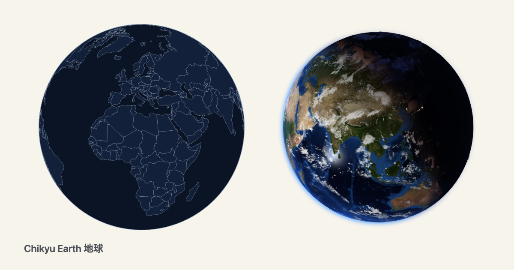
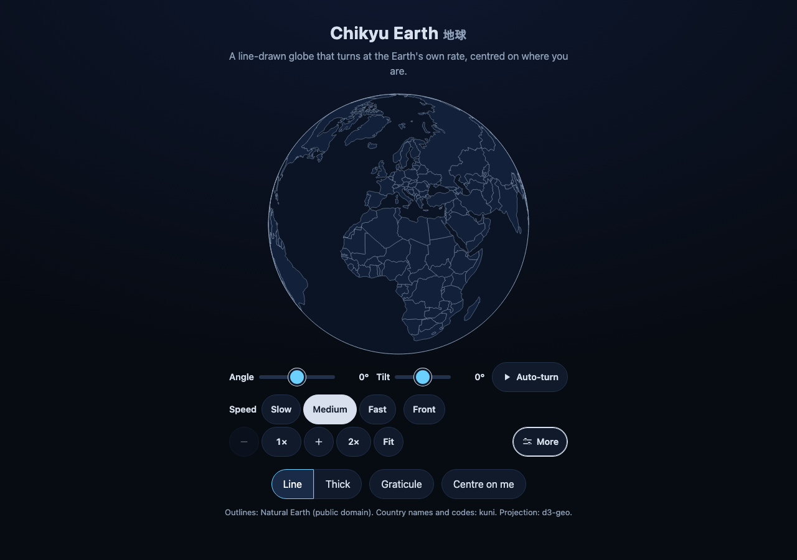
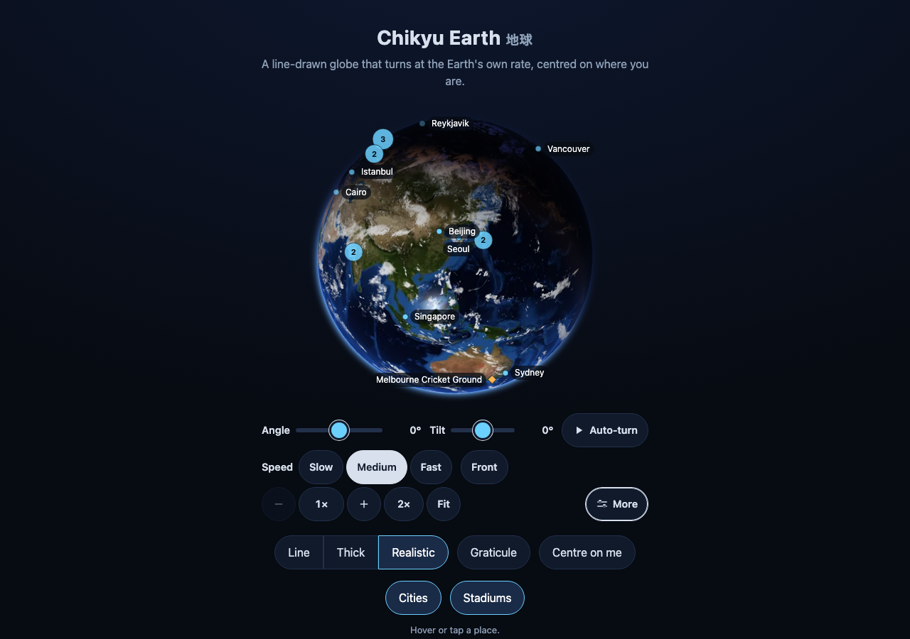
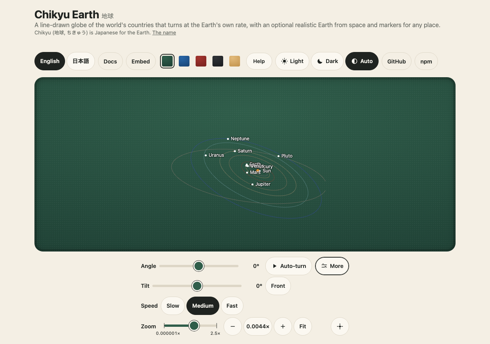
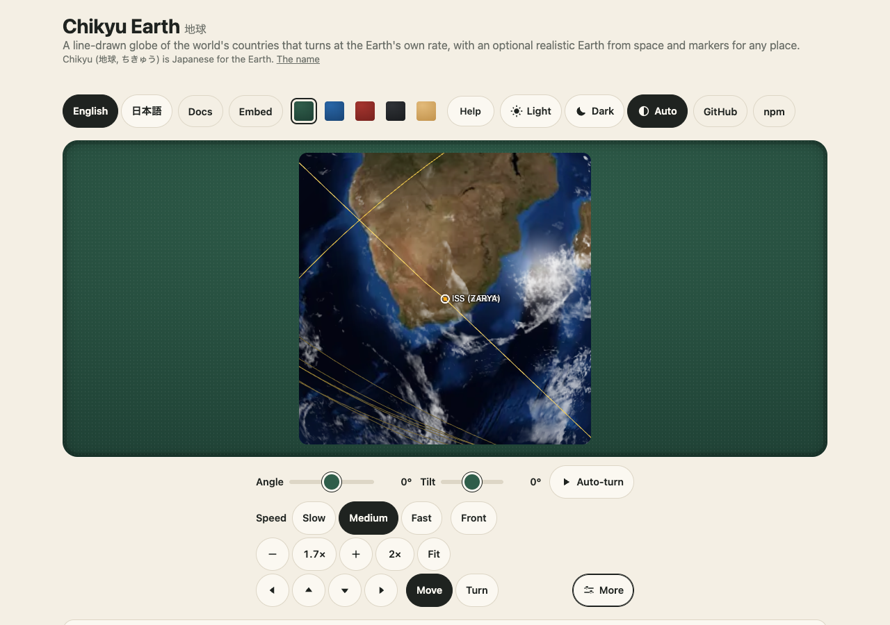
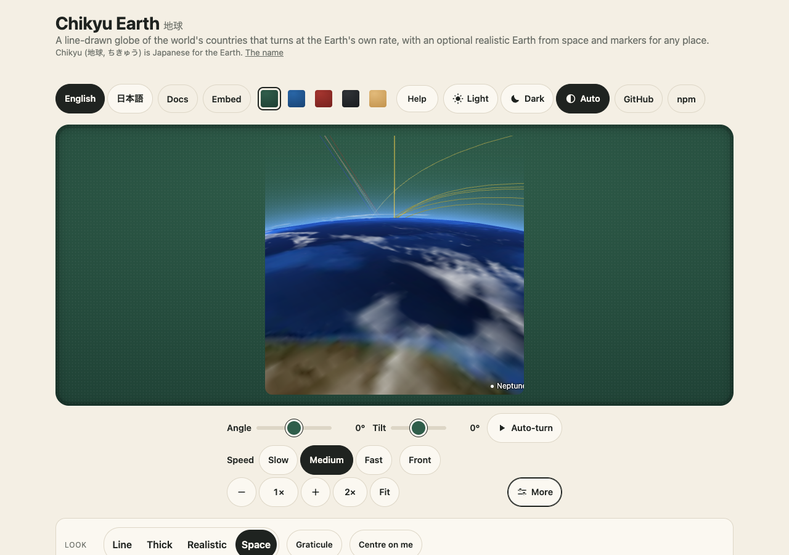
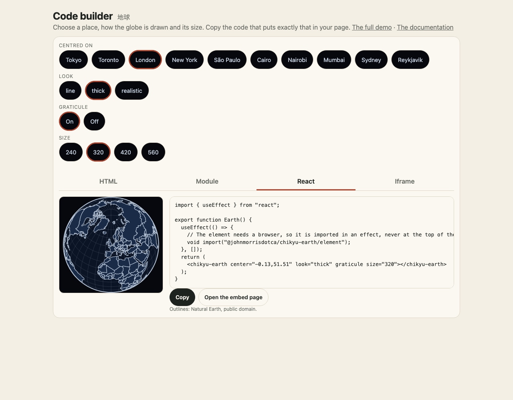

<p align="center"><a href="https://johnmorrisdotca.github.io/chikyu-earth/"><picture><source media="(prefers-color-scheme: dark)" srcset="https://raw.githubusercontent.com/johnmorrisdotca/chikyu-earth/main/docs/images/thumbnail-dark.png"></picture></a></p>

<h1 align="center">Chikyu Earth <sub>地球</sub></h1>

<p align="center"><strong>A line-drawn globe that turns at the Earth's own rate, and opens centred on where you are.</strong><br>
Country outlines in the same thin-line style as Hako Devices and Uchusen Rockets: an orthographic disc, the countries drawn on it, and the rim. One SVG, no canvas.</p>

<p align="center">Part of <strong>Space Program X (SPX)</strong>, the space packages: <a href="https://github.com/johnmorrisdotca/wakusei-planets">Wakusei Planets</a> · <a href="https://github.com/johnmorrisdotca/hoshi-stars">Hoshi Stars</a> · <a href="https://github.com/johnmorrisdotca/chikyu-earth">Chikyu Earth</a> · <a href="https://github.com/johnmorrisdotca/uchusen-rockets">Uchusen Rockets</a></p>

<p align="center">
  <a href="https://github.com/johnmorrisdotca/chikyu-earth/actions/workflows/ci.yml"></a>
  <a href="./LICENSE"></a>
  
</p>

<p align="center"><a href="https://johnmorrisdotca.github.io/chikyu-earth/"><strong>Open the demo →</strong></a> · <a href="https://johnmorrisdotca.github.io/chikyu-earth/embed.html">Embed page</a> · <a href="https://johnmorrisdotca.github.io/chikyu-earth/docs/">Docs</a></p>

<p align="center"></p>

## Who it is for

- **A developer who wants a globe on a page** with one tag, no build step, no canvas, and an SVG that prints sharply.
- **A site with a place on it**: a team, a venue, a flight, a satellite pass. Markers move with the globe and gather into clusters.
- **A teacher or writer** who wants the Earth turning at its own rate, and the Sun, Moon and planets where they are on a date.
- **A maker of tools** who wants countries as data: outlines, English and Japanese names and two-letter codes, with no network.

## Features

- A line-drawn globe as one SVG: country outlines on an orthographic disc, in two looks (`line`, `thick`), with an optional graticule.
- It opens centred on where the reader is, or where you say. Auto-turn runs at the Earth's own rate: one sidereal day a turn, and the family's speed buttons (0.5×, 1×, 2×) are multiples of it.
- The Earth from space (`/realistic`): day and night by the real Sun, city lights, sun glint, clouds and the atmosphere, drawn with three.js through one shared WebGL context.
- The Sun, the Moon and the planets where they are on a date and time (`/space`), and satellites at the places SGP4 puts them (`/satellites`), with a camera that rides along.
- When you can see the ISS (`/passes`): the next passes of the ISS, Tiangong and Hubble over any place, with direction, height, brightness and whether the satellite is lit while the sky is dark, a sky dome that draws each, and `<chikyu-passes>`.
- Markers with labels, groups, clusters and events (`/markers`), on either globe.
- Pure parts that run on a server: `globe()`, the rotation and view maths, `COUNTRIES` and `countryList()`.
- Every live view zooms, pans and turns by itself, with no bar: drag, two-finger pinch, Ctrl and the wheel (a plain wheel at Fit scrolls the page) and the keys, through kazoku-ui's controls, from a tenth of Fit to 20 times on the line globe ([each range and why](docs/guides/zoom-and-pan.md)). Add `<kazoku-view-controls>` for buttons and the address.
- Names in English and Japanese, and a strict content security policy is enough.

## Install and use

```sh
npm install @johnmorrisdotca/chikyu-earth
```

Or use no install at all: every example below was run in a browser, built or type-checked by `pnpm test:usage` against the package as npm packs it, and the guides hold the same text.

### In a plain HTML page

One script tag from [jsDelivr](https://www.jsdelivr.com/package/npm/@johnmorrisdotca/chikyu-earth) and the tag. (From unpkg, with the realistic Earth, and pinning a version: [the CDN guide](docs/guides/html-and-cdn.md).)

```html
<!doctype html>
<html lang="en">
  <head>
    <meta charset="utf-8" />
    <meta name="viewport" content="width=device-width, initial-scale=1" />
    <title>Chikyu Earth from jsDelivr</title>
    <script type="module" src="https://cdn.jsdelivr.net/npm/@johnmorrisdotca/chikyu-earth/element/+esm"></script>
  </head>
  <body>
    <chikyu-earth center="139.7,35.7" look="thick" graticule size="320"></chikyu-earth>
  </body>
</html>
```

The globe appears centred where you say; with no `center` it centres on the reader (the browser asks for their location; until they answer, and if they decline, it starts on the Greenwich meridian). `look` is `line` or `thick`. It also zooms and turns: drag, pinch, Ctrl and the wheel, the arrow keys (`controls="none"` takes that off).

### With the shared controls

The [kazoku-ui](https://github.com/johnmorrisdotca/kazoku-ui) view controls bar adds buttons and a slider and keeps the view in the address. One listener passes its camera on:

```html
<!doctype html>
<html lang="en">
  <head>
    <meta charset="utf-8" />
    <meta name="viewport" content="width=device-width, initial-scale=1" />
    <title>Chikyu Earth with the shared controls</title>
    <script type="module">
      import "https://cdn.jsdelivr.net/npm/@johnmorrisdotca/kazoku-ui/view-controls/define/+esm";
      import "https://cdn.jsdelivr.net/npm/@johnmorrisdotca/chikyu-earth/element/+esm";

      const earth = document.querySelector("chikyu-earth");
      document.querySelector("kazoku-view-controls").addEventListener("kazoku-viewchange", (event) => {
        earth.setView(event.detail, event.detail.final, event.detail.reason !== "auto");
      });
    </script>
  </head>
  <body>
    <chikyu-earth id="earth" size="420" look="thick" center="139.7,35.7" tabindex="0"></chikyu-earth>
    <kazoku-view-controls for="earth" address grab-radius="fit" controls="advanced" tilt-max="90" speed="0.004178"></kazoku-view-controls>
  </body>
</html>
```

Auto-turn (add `autoplay`) moves at the Earth's own rate: `0.004178` degrees a second, one sidereal day — 23 h 56 min 4.0905 s — per revolution.

### In React

The element needs a browser, so it is imported inside the effect, never at the top of the file; that keeps a server render working. (Vue, Svelte and Angular do the same: [the frameworks guide](docs/guides/frameworks.md).)

```tsx
import { useEffect, useRef } from "react";

export function ChikyuEarth({ center = "139.7,35.7", look = "thick" }: { center?: string; look?: "line" | "thick" }) {
  const host = useRef<HTMLDivElement>(null);
  useEffect(() => {
    // The element needs a browser, so it is imported here, never at the top of the file: a server render never reaches an effect.
    void import("@johnmorrisdotca/chikyu-earth/element");
  }, []);
  return (
    <div ref={host}>
      <chikyu-earth center={center} look={look} graticule />
    </div>
  );
}
```

### Every other way

| How | Where |
|---|---|
| A script tag from jsDelivr or unpkg, the realistic Earth from a CDN | [CDN guide](docs/guides/html-and-cdn.md) |
| An ES module in Vite or webpack | [bundlers guide](docs/guides/bundlers.md) |
| React, Vue, Svelte, Angular; Next.js, Nuxt, SvelteKit | [frameworks guide](docs/guides/frameworks.md) |
| An `<iframe>` of the embed page, no script of your own | [iframe guide](docs/guides/embed-in-an-iframe.md) |
| TypeScript types, an SVG string on a server, Node | [TypeScript and Node guide](docs/guides/typescript-and-node.md) |
| The web component (`<chikyu-earth>`, `<chikyu-earth-realistic>`) | every one of the above; its attributes are in [The element](#the-element) |
| Something does not appear | [troubleshooting](docs/guides/troubleshooting.md) |

The guides are also in Japanese (日本語), one language to a page: [docs/guides/ja/](docs/guides/ja/getting-started.md).

## Two packages: the Earth here, the rest in wakusei-planets

Chikyu Earth is for someone who cares about the Earth only: the countries, day and night, city lights, clouds, markers and the satellites round it. The Sun, the other planets and the moons, where each one is on a date, and the solar system as a scene are [wakusei-planets](https://github.com/johnmorrisdotca/wakusei-planets). The dependency runs one way: wakusei-planets may use chikyu-earth, and chikyu-earth never needs wakusei-planets. A page about a city or a flight installs only this one, a page about Saturn only the other, and a page about the Earth in the solar system both; with both, wakusei-planets' line Earth is this package's globe with the countries:

```sh
npm install @johnmorrisdotca/chikyu-earth @johnmorrisdotca/wakusei-planets
```

```ts no-run
import "@johnmorrisdotca/chikyu-earth/element";
import "@johnmorrisdotca/wakusei-planets/element";
import "@johnmorrisdotca/wakusei-planets/earth";
```

The full page, the rule and what lives where, each example run by `pnpm test:usage`: [Why two packages](docs/guides/two-packages.md).

## The Earth from space

An optional second look, for a page with room for a real picture: day and night by the real Sun, cities' lights, a sun glint on the sea, a cloud layer and the
atmosphere at the rim, drawn with three.js through kazoku-ui's shared renderer. It is its own entry point, so the line globe above costs nothing extra.

<p align="center"></p>

```html
<script type="module">
  import "@johnmorrisdotca/chikyu-earth/realistic/element";
</script>
<chikyu-earth-realistic center="139.7,35.7" time="2026-06-21T03:00Z" texture-base="/textures/"></chikyu-earth-realistic>
```

Needs `three` and `@johnmorrisdotca/kazoku-ui` (both optional peers) and the pictures (1.6 MB, from NASA, in `dist/textures/`). It draws nothing while nothing changes,
at most 30 times a second while it does, in one WebGL context, with textures that grow as you zoom and are freed after. With `tiles="/tiles/"` (a folder of NASA map
tiles, [how](docs/guides/earth-tiles.md)) it loads only the finer tiles in view, so you can zoom in to 20 times and stay sharp. With `speed="86400"` (a day a second; the name `<chikyu-space>` uses) its clock runs on from the date shown and the Sun, the night side and the clouds follow it ([guide](docs/guides/time-and-play.md)). `immersive` fills the window, `camera="space"` holds the camera in the stars so the Earth turns beneath it, and it draws every satellite group at once ([guide](docs/guides/full-screen-and-camera.md)). All of it, the budget and the tests:
[docs/realistic.md](docs/realistic.md).

## The Sun, the Moon and the planets

`<chikyu-space>` (`@johnmorrisdotca/chikyu-earth/space/element`) places the Earth, the Moon, the Sun, the planets and Pluto (the real ones, with their moons, when [wakusei-planets](https://github.com/johnmorrisdotca/wakusei-planets) is installed: [guide](docs/guides/the-real-planets.md)) where they are at a date and time, with the Moon's phase and the Earth's day side
from the light, a compressed scale you can read (and a true one that shows how empty it is), time that runs forwards or backwards (Play, Pause and Back in the demo, and a `chikyu-timechange` event for a date box to follow: [guide](docs/guides/time-and-play.md)), and a zoom from the Earth to the solar system. Positions are
computed in the browser by astronomy-engine (MIT), nothing is fetched. [docs/space.md](docs/space.md). The solar system is wakusei-planets' to own, so this view is moving there; this package keeps the Earth and its satellites ([why two packages](docs/guides/two-packages.md)).

<p align="center"></p>

## Satellites

The ISS, a space station or thousands of Starlink satellites at the places SGP4 puts them for the date and time shown, on `<chikyu-space>`: a group is one draw call however many it holds, press one to get its name, height and speed, and its orbit is drawn. Chikyu fetches nothing: your page passes in orbital elements (CelesTrak's JSON, within its usage policy), and satellite.js (MIT, an optional peer) does the maths about once a second, with every frame between interpolated. `fetchElements(url)` reads OMM JSON, CSV or TLE from an address you choose, politely (https, not again within two hours, stop on any answer that is not 200). A satellite whose elements are more than 14 days from the time shown is drawn dimmer, and one more than 30 days away is left out. A group is hidden while the clock runs faster than 60 times real time. A small catalogue (`SATELLITE_GROUPS`, `CATALOGUE`, `findInCatalogue`) names fourteen groups (stations, weather, GPS, Galileo, OneWeb and more) and about forty satellites worth following, with no elements in it. The guide has the rules for getting elements and the budget, each line tested: [satellites guide](docs/guides/satellites.md), [docs/satellites.md](docs/satellites.md).

<p align="center"></p>

```ts no-run
import "@johnmorrisdotca/chikyu-earth/space/element";
import { createSatellites, type ElementSet } from "@johnmorrisdotca/chikyu-earth/satellites";

const elements: ElementSet[] = await (await fetch("/my-celestrak-copy.json")).json();
document.querySelector("chikyu-space")!.setSatellites("stations", createSatellites(elements), { orbits: true });
```

## Passes: when can I see the ISS?

`findPasses(elements, place, { from, to })` gives the next passes of a satellite over a place: when it comes up, is highest and goes down (UTC, with the compass word and degrees at each, and the height), how bright it looks, and whether it can be seen, which needs the satellite in sunlight while the watcher's sky is in civil twilight or darker (each pass says which). It is a pure function over the same SGP4 as the rest, with no DOM and no clock. `skySvg` draws a pass across the sky as an SVG string, `groundTrack` gives the path under the satellite for a globe, and `<chikyu-passes>` lists the passes and draws the dome, in English and Japanese. The ISS, Tianhe and Hubble have estimated standard magnitudes (from their size and an assumed albedo); give better ones with `magnitudes`.

```ts
import { findPasses } from "@johnmorrisdotca/chikyu-earth/passes";

const iss = {
  OBJECT_NAME: "ISS (ZARYA)",
  EPOCH: "2026-11-09T04:58:46.240896",
  MEAN_MOTION: 15.49270212,
  ECCENTRICITY: 0.00072974,
  INCLINATION: 51.6321,
  RA_OF_ASC_NODE: 302.4538,
  ARG_OF_PERICENTER: 5.2479,
  MEAN_ANOMALY: 354.8585,
  NORAD_CAT_ID: 25544,
  BSTAR: 0.0001553356,
  MEAN_MOTION_DOT: 8.201e-5,
  MEAN_MOTION_DDOT: 0,
};
const from = Date.UTC(2026, 10, 10);
const tokyo = { latitude: 35.69, longitude: 139.69 };
const [next] = findPasses(iss, tokyo, { from, to: from + 5 * 86_400_000 });
console.log(next ? `${new Date(next.highest.ms).toISOString()}: ${next.highest.compass}, ${Math.round(next.highest.altitude)} degrees, ${next.sky}` : "none");
```

Passes are only as good as the orbit data are new: each pass says how old its elements are, and the ISS's change with every reboost. Checked against Skyfield (249 passes: every time within a second, directions within 0.06 degree), and by hand against a sky-watching site's published predictions (all found, times within two seconds). Brightness is a model from the satellite's size, good to a magnitude or two. The guide has the numbers and the rules: [passes guide](docs/guides/passes.md). The demo's page [Passes over me](https://johnmorrisdotca.github.io/chikyu-earth/passes.html) has a map, a search, "My location" (asked for only when pressed) and the code for every way a page is made.

## Riding along

<p align="center"></p>

`space.ride({ group: "stations", index: 0 }, { look: "horizon" })` puts the camera on the ISS (or a Starlink satellite, the Moon, a planet) at its real place for the moment shown and looks at the Earth, which goes by beneath
as the body moves along its orbit; switch to another body and the camera glides there. Straight down or toward the horizon, from the body or following it at a distance, time faster or slower. It animates continuously, so it keeps to the
same budget: at most 30 frames a second (one a second for reduced motion), nothing drawn while paused, out of sight or hidden. [Ride along guide](docs/guides/ride-along.md), [docs/ride-along.md](docs/ride-along.md).

## Printable sheets

`@johnmorrisdotca/chikyu-earth/sheets` draws five printable sheets for children and everyone as SVG strings measured in millimetres, with no browser and no dependency: the globe to colour (the continents in thick outlines, the continents and oceans named; three sides), a world map, a "my country" sheet (the outline, the capital as a star, a box to draw the flag), day and night for a date and time (the line between them from the package's own sun position, the night hatched so black and white prints well) and the seasons (the Earth at four points round the Sun, tilted 23.4 degrees). A4, US Letter, A3 or Tabloid, English or Japanese, thick lines and big type (`kid`) or thin and small (`normal`). The demo's [sheets page](https://johnmorrisdotca.github.io/chikyu-earth/kids.html) puts kazoku-ui's header (the brand, the title, a Name box) and footer (credits, version, a QR code) round them and has Print / save PDF, and the Pages build makes [ready-made PDFs](https://johnmorrisdotca.github.io/chikyu-earth/pdf/). [Guide](docs/guides/printable-sheets.md).

```ts
import { dayNightSvg, globeSheetSvg, terminator } from "@johnmorrisdotca/chikyu-earth/sheets";

const room = { widthMm: 184.6, heightMm: 180 };
console.log(globeSheetSvg("americas", { ...room, lang: "en" }).includes("North"));
console.log(dayNightSvg(Date.UTC(2026, 5, 21, 12), room).includes('data-sun="0.'), terminator(Date.UTC(2026, 5, 21, 12), 12).length);
```

## Markers

Mark any place at `[lon, lat]` with a label, colour or icon, in groups you can show or hide, on either look. Chikyu ships no places; yours move with the globe, fade on the far side, make room
for their labels, gather into clusters when crowded, and fire hover, click and keyboard events with your own data. One canvas pass for thousands, a pool of 24 buttons for the labels. [docs/markers.md](docs/markers.md).

```ts no-run
import "@johnmorrisdotca/chikyu-earth/element";
import { attachMarkers } from "@johnmorrisdotca/chikyu-earth/markers";

const markers = attachMarkers(document.querySelector("chikyu-earth")!);
markers.add({ id: "tokyo", lon: 139.69, lat: 35.69, label: "Tokyo", group: "Cities" });
```

## Controls

The elements carry the shared [kazoku-ui view controls](https://github.com/johnmorrisdotca/kazoku-ui) themselves, so
every live view zooms, pans and turns with no bar: drag to turn (and move, once zoomed), touch pinch, Ctrl and the
wheel to zoom (a plain wheel at Fit scrolls the page), the arrow keys, `+`, `-` and `0` once the element is focused.
`controls="none"` takes the hands off; `zoom-min` and `zoom-max` change the range. Chikyu does not draw its own zoom,
rotate or drag controls.

| Element | Zoom range | Why it stops there |
| --- | --- | --- |
| `<chikyu-earth>` | 0.1 to 20 times | Natural Earth 1:110m outlines, redrawn at each zoom; at 20 times the view is about 640 km across and a coast is a few straight segments |
| `<chikyu-earth-realistic>` | 0.1 to 5 times; 20 with `tiles` found | the package's pictures are 4096 pixels across at most; the finest tile level is 4 times that |
| `<chikyu-space>` | a millionth to 2.5 times; 0.5 to 6 riding from a body | the zoom is the camera's distance (the whole solar system needs a millionth); close in, the Earth's picture and the textures stay sharp to 2.5 |

[Zoom, pan and turn](docs/guides/zoom-and-pan.md) says more. For buttons, a slider, Auto-turn and the address, add the
bar for the element (give it an `id` and a `tabindex`); it takes the hands over and the page applies its events:

```html
<chikyu-earth id="earth" size="420" tabindex="0"></chikyu-earth>
<kazoku-view-controls id="controls" for="earth" address grab-radius="fit" controls="advanced" tilt-max="90" speed="0.004178" autoplay></kazoku-view-controls>
```

```ts no-run
import "@johnmorrisdotca/chikyu-earth/element";
import "@johnmorrisdotca/kazoku-ui/view-controls/define";
import type { ViewChangeDetail } from "@johnmorrisdotca/kazoku-ui/view-controls/element";

const earth = document.querySelector("chikyu-earth")!;
document.getElementById("controls")!.addEventListener("kazoku-viewchange", (event) => {
  const { yaw, tilt, zoom, panX, panY, final } = (event as CustomEvent<ViewChangeDetail>).detail;
  earth.setView({ yaw, tilt, zoom, panX, panY }, final);
});
```

The mapping is `rotate([lambda0 + yaw, phi0 + tilt])`, `scale(baseScale * zoom)` and
`translate([cx + panX, cy + panY])`, where `lambda0` and `phi0` are the home centre. Front returns to that home
view. Auto-turn's `0.004178` degrees a second is 360° per sidereal day; kazoku-ui leaves it still for a reader who
prefers reduced motion, and a drag or zoom never stops or resets it.

## Draw one as a string

`globe()` returns the SVG markup, so a server, a build step or a test can draw the same globe with no DOM:

```ts
import { globe } from "@johnmorrisdotca/chikyu-earth";

const svg = globe({ size: 320, rotation: [-139.7, -35.7], style: "line" });
```

The rotation is the pair d3-geo's `rotate` takes: `[-longitude, -latitude]` centres that place. The helpers in
`rotate.ts` do the time maths — `SIDEREAL_DAY_MS`, `spinAt(ms)`, `centreRotation(point)` and
`rotationAt(centre, now, start)`.

## The element

| Attribute | What it does | Default |
| --- | --- | --- |
| `size` | Width and height of the square SVG, in pixels. | `320` |
| `center` | `"longitude,latitude"` to centre on. Wins over geolocation. | the reader's location, else `0,0` |
| `look` | `line` or `thick`. (`style` is the older name for it: a framework reads `style` as CSS, so use `look` there.) | `line` |
| `graticule` | Draw a light graticule under the countries. | off |
| `controls` | `none` takes off the drag, pinch, wheel and keys the element carries. | on |
| `zoom-min`, `zoom-max` | The zoom range, over the element's own (0.1 to 20). | 0.1, 20 |

`setView(view, final = true)` applies a shared controller's `{ yaw, tilt, zoom, panX, panY }`. Every call updates
the state; pass `final: false` for the cheap relative transform during a gesture and `final: true` for the full
projection redraw. `projectionView(centre, size, view)` is the same mapping as a pure function: yaw is added to the
home longitude, tilt is subtracted from its latitude, zoom multiplies the scale, and pan offsets the translation.
Front is therefore the home centre; Fit is 1x with no pan.

## The data

Every country the globe draws comes from [chizu](https://github.com/johnmorrisdotca/chizu)'s `world-geo` entry
(`@johnmorrisdotca/chizu/world-geo`): **Natural Earth** 1:110m (public domain) as longitude and latitude, with
chizu's English and Japanese names. Nothing is fetched at runtime. `COUNTRIES` is that GeoJSON (177 features,
Antarctica included); `countryList()` is just the names and codes. `alpha2` is the two-letter code, `XK` for Kosovo,
and `null` for Northern Cyprus and Somaliland, which have none:

```ts
import { countryList } from "@johnmorrisdotca/chikyu-earth";

countryList().find((c) => c.alpha2 === "JP"); // { name: "Japan", ja: "日本", alpha2: "JP" }
```

To take newer outlines, update `@johnmorrisdotca/chizu`; there is no data file in this repository.

## Examples

Every `ts` block in this README that is not marked `no-run` is type-checked and run against the package as npm packs it (`pnpm test:readme`).

```ts
import { COUNTRIES, countryList } from "@johnmorrisdotca/chikyu-earth";

COUNTRIES.features.length; // 177
countryList().find((country) => country.alpha2 === "CA")?.ja; // "カナダ"
```

A globe with a graticule, centred on Tokyo, as a string:

```ts
import { globe } from "@johnmorrisdotca/chikyu-earth";

const svg = globe({ size: 240, style: "thick", centre: { lon: 139.7, lat: 35.7 }, graticule: true });
if (!svg.startsWith("<svg")) throw new Error("not an SVG");
```

The turn of the Earth, from the time:

```ts
import { centreRotation, rotationAt, SIDEREAL_DAY_MS, spinAt } from "@johnmorrisdotca/chikyu-earth";

const tokyo = { lon: 139.7, lat: 35.7 };
console.log(centreRotation(tokyo), rotationAt(tokyo, SIDEREAL_DAY_MS / 2, 0), spinAt(SIDEREAL_DAY_MS / 4));
```

What a shared controller's camera means for the projection:

```ts
import { HOME_VIEW, projectionView } from "@johnmorrisdotca/chikyu-earth";

const view = projectionView({ lon: 0, lat: 0 }, 400, { ...HOME_VIEW, zoom: 2 });
console.log(view.scale, view.translate);
```

A look that does not exist falls back to the default instead of failing:

```ts
import { cleanStyle, STYLE_NAMES } from "@johnmorrisdotca/chikyu-earth";

console.log(STYLE_NAMES, cleanStyle("neon"));
```

The globe with a graticule and the realistic Earth, side by side in HTML:

```html
<chikyu-earth center="-79.38,43.65" look="line" graticule size="240"></chikyu-earth>
<chikyu-earth-realistic center="-79.38,43.65" time="2026-06-21T12:00Z" style="display: block; width: 240px"></chikyu-earth-realistic>
```

A page that cannot run script uses an iframe of the embed page:

```html
<iframe src="https://johnmorrisdotca.github.io/chikyu-earth/embed.html?look=thick&center=10,30&graticule=1" title="The Earth" width="320" height="320" style="border:0"></iframe>
```

## The code builder

[The code builder](https://johnmorrisdotca.github.io/chikyu-earth/builder.html) is one screen, and the demo's "Put it in your page" is the same panel (the family's `<kazoku-embed-panel>`): choose the place to centre on, the look, the graticule and the size, then pick how your page is made (HTML from a CDN, a module, React, Vue, Angular, Svelte or an iframe) and copy the code. The picture beside the code is made from the same choices; Open the embed page, Read the docs and the credit line are under it. It writes the same text the guides show.

<p align="center"></p>

## API

The reference is a site, made from the source's own doc comments: every export has a summary, its parameters, what it returns and an example that runs when the site is built. [Open the reference](https://johnmorrisdotca.github.io/chikyu-earth/docs/).

| Entry point | What it gives |
| --- | --- |
| `@johnmorrisdotca/chikyu-earth` | The pure side: `globe`, `COUNTRIES`, `countryList`, the looks, the rotation and view maths. No browser. |
| `.../element` | `<chikyu-earth>`. |
| `.../realistic`, `.../realistic/element` | The Earth from space; `three` for the element. |
| `.../markers` | `attachMarkers` and the pure projection, clusters and labels. |
| `.../space`, `.../space/element` | The Sun, the Moon and the planets; `astronomy-engine` and `three`. |
| `.../satellites` | SGP4 for a group of satellites; `satellite.js`. |
| `.../passes`, `.../passes/element` | Passes of a satellite over a place, the sky dome, `<chikyu-passes>`; `satellite.js`. |

## Guides

Each guide has a Japanese twin in [docs/guides/ja](docs/guides/ja/getting-started.md).

| Guide | What it is for |
| --- | --- |
| [Getting started](docs/guides/getting-started.md) | A globe on a page |
| [HTML and CDN](docs/guides/html-and-cdn.md) | A script tag from jsDelivr or unpkg |
| [Bundlers](docs/guides/bundlers.md) | Vite and webpack |
| [Frameworks](docs/guides/frameworks.md) | React, Vue, Svelte, Angular |
| [Embed in an iframe](docs/guides/embed-in-an-iframe.md) | No script of your own |
| [TypeScript and Node](docs/guides/typescript-and-node.md) | Types and the pure side |
| [The realistic Earth and markers](docs/guides/realistic-and-markers.md) | The Earth from space, markers |
| [Satellites](docs/guides/satellites.md) | SGP4 and the space view |
| [Full screen, the camera in the stars and every satellite](docs/guides/full-screen-and-camera.md) | `immersive`, `camera="space"`, the Earth's look, and every satellite group on the realistic Earth |
| [When can I see the ISS?](docs/guides/passes.md) | Passes over a place, the sky dome, how it was checked |
| [Ride along](docs/guides/ride-along.md) | A camera on a moving body |
| [The date follows the clock, and Play](docs/guides/time-and-play.md) | The `chikyu-timechange` event, a `speed` for the space view and the realistic Earth, Play, Pause and Back |
| [Zoom, pan and turn](docs/guides/zoom-and-pan.md) | The hands every view carries, each zoom range and why |
| [Printable sheets](docs/guides/printable-sheets.md) | The globe, a world map, my country, day and night and the seasons to print and colour |
| [Why two packages](docs/guides/two-packages.md) | This package and wakusei-planets: which to install, alone and together |
| [How it stays light](docs/guides/how-it-works.md) | The budget |
| [Architecture](docs/guides/architecture.md) | How the layers fit |
| [Troubleshooting](docs/guides/troubleshooting.md) | Something does not appear |
| [Upgrading](docs/guides/upgrading.md) | What to act on between versions |

## Limits

- The outlines are Natural Earth 1:110m: good for a globe, not for a street map. `COUNTRIES` has 177 features, Antarctica included.
- Three places have no two-letter code (`alpha2` is `null`), and Kosovo is `XK`.
- The Earth from space and the space view need WebGL; without it the line globe is drawn.
- Satellite elements are a day's snapshot you supply; the package fetches nothing. The positions are SGP4's, good for a picture, not for pointing an antenna.

```ts
import { countryList } from "@johnmorrisdotca/chikyu-earth";

console.log(countryList().filter((country) => country.alpha2 === null).map((country) => country.name));
```

## Accessibility

- A reader who prefers reduced motion gets a still globe, and the riding-along camera draws at most one frame a second.
- The view takes the keyboard through the shared controls, and the markers' labels are real buttons.
- Names are available in English and Japanese.

```html
<div id="globe" tabindex="0" role="group" aria-label="The Earth"><chikyu-earth size="420"></chikyu-earth></div>
```

## Browser and runtime support

- The package needs Node 24 or later. The pure side runs in Node and in any current browser; the elements need a current browser.
- The Earth from space and the space view need WebGL and `three` `>=0.160.0` (an optional peer); the space view also needs `astronomy-engine`, and satellites `satellite.js`:

```sh
npm install three astronomy-engine satellite.js
```

- The tests run the demo in Chromium and WebKit at a phone's width and a desk's, with WebGL drawn in software.

## Languages

The countries have English and Japanese names (`countryList()` gives `name` and `ja`), the demo is in both, and every guide in [docs/guides](docs/guides) has a Japanese twin in [docs/guides/ja](docs/guides/ja/getting-started.md), one language to a page.

```ts
import { countryList } from "@johnmorrisdotca/chikyu-earth";

console.log(countryList().find((country) => country.alpha2 === "JP"));
```

## Architecture

One small core and four optional layers, each its own entry point. The core is a pure function that returns an SVG string; the layers add the Earth from space, markers, the space view and satellites. [Architecture](docs/guides/architecture.md) has the layers.

```ts
import { DEGREES_PER_MS } from "@johnmorrisdotca/chikyu-earth";

console.log((DEGREES_PER_MS * 1000).toFixed(6), "degrees a second");
```

## Development

```sh
pnpm install
pnpm check         # lint, types, unit tests, the build and the packed package
pnpm test:readme   # the README's ts blocks, type-checked and run against the packed package
pnpm test:usage    # every way of using it, built or run
pnpm docs:check    # the reference site's checks
pnpm test:demo     # the demo, the embed page and the docs site in a real browser
pnpm dev           # the demo on http://127.0.0.1:8200/chikyu-earth/
```

## Contributing

See [CONTRIBUTING.md](CONTRIBUTING.md). Work in a git worktree from `origin/main`, one branch per change:

```sh
git worktree add ../chikyu-work -b my-change origin/main
```

The rules that matter most: draw from public facts and cite them, no data of our own, a look changes lines and fills and never the geometry, and a fact with no source is left out.

## Changes

[CHANGELOG.md](CHANGELOG.md) lists every release with its date.

## Licence

MIT: see [LICENSE](LICENSE). The outlines are Natural Earth's (public domain), and the realistic Earth's pictures are made from NASA Earth Observatory images: [NOTICE.md](NOTICE.md) says what each rests on.

## The name

Chikyu (地球, ちきゅう) is Japanese for the Earth.

## The family

<!-- family:start (made by scripts/family-readme.mjs from scripts/family-template.mjs; change those, not this) -->
Chikyu Earth is one of forty-one packages, each made for the same site, each at
[github.com/johnmorrisdotca](https://github.com/johnmorrisdotca) or [github.com/spxis](https://github.com/spxis). The code of every one is MIT.

**Games — board**

- [Domino](https://github.com/johnmorrisdotca/domino) (ドミノ): dominoes and Mexican Train. [Demo](https://johnmorrisdotca.github.io/domino/).
- [Gunjin](https://github.com/johnmorrisdotca/gunjin) (軍人): five hidden-rank strategy games with pass-the-device play. [Demo](https://johnmorrisdotca.github.io/gunjin/).
- [Narabe](https://github.com/johnmorrisdotca/narabe) (並べ): one rules engine for abstract board games, from gomoku and Reversi to Go and checkers. [Demo](https://johnmorrisdotca.github.io/narabe/).
- [Sugoroku](https://github.com/johnmorrisdotca/sugoroku) (双六): backgammon and its variants, with the doubling cube and match play. [Demo](https://johnmorrisdotca.github.io/sugoroku/).
- [Tenka](https://github.com/johnmorrisdotca/tenka) (天下): world conquest for two to six, on a map of the real world. [Demo](https://johnmorrisdotca.github.io/tenka/).

**Games — cards & tiles**

- [Fuda Cards](https://github.com/johnmorrisdotca/fuda-cards) (札): collectible card frames with a true thickness, foil, stacks, wear and a binder, as two web components. [Demo](https://johnmorrisdotca.github.io/fuda-cards/).
- [Hitotsu](https://github.com/johnmorrisdotca/hitotsu) (一つ): a colour-card shedding game for two to eight, with the house rules people play. [Demo](https://johnmorrisdotca.github.io/hitotsu/).
- [Jarajara](https://github.com/johnmorrisdotca/jarajara) (ジャラジャラ): mahjong tiles drawn as SVG, stacked layouts, and the matching solitaire Awase. [Demo](https://johnmorrisdotca.github.io/jarajara/).
- [Kumimoji](https://github.com/johnmorrisdotca/kumimoji) (組み文字): a crossword tile race, in English and Japanese kana. [Demo](https://johnmorrisdotca.github.io/kumimoji/).
- [Toranpu](https://github.com/johnmorrisdotca/toranpu) (トランプ): a deck of playing cards, card games with computer players, and solitaires. [Demo](https://johnmorrisdotca.github.io/toranpu/).

**Games — puzzles**

- [Houseki](https://github.com/johnmorrisdotca/houseki) (宝石): gem and stone matching puzzles: falling triplets, stone collapse, colour chains and gem swap. [Demo](https://johnmorrisdotca.github.io/houseki/).
- [Jirai](https://github.com/johnmorrisdotca/jirai) (地雷): minesweeper on shaped grids with verified no-guess boards. [Demo](https://johnmorrisdotca.github.io/jirai/).
- [Karakuri](https://github.com/johnmorrisdotca/karakuri) (からくり): eight hyper-casual puzzle games, some of them physics: draw a shield, pull pins, cut ropes, slide blocks, pour tubes. [Demo](https://johnmorrisdotca.github.io/karakuri/).
- [Kazu](https://github.com/johnmorrisdotca/kazu) (数): grid number puzzles: Sudoku and its variants, Futoshiki and Skyscrapers. [Demo](https://johnmorrisdotca.github.io/kazu/).
- [Kyuubu](https://github.com/johnmorrisdotca/kyuubu) (キューブ): a turning cube for the browser, 2×2 to 7×7, with record solves to replay. [Demo](https://johnmorrisdotca.github.io/kyuubu/).
- [Meikyuu](https://github.com/johnmorrisdotca/meikyuu) (迷宮): mazes on squares, hexagons, triangles and circles, made from a seed and drawn through with a finger or the mouse. [Demo](https://johnmorrisdotca.github.io/meikyuu/).
- [Suido](https://github.com/johnmorrisdotca/suido) (水道): a pipe puzzle: turn the pieces until the water reaches every drain. [Demo](https://johnmorrisdotca.github.io/suido/).
- [Tobiishi](https://github.com/johnmorrisdotca/tobiishi) (飛び石): peg solitaire with nine boards and seeded solvable challenges. [Demo](https://johnmorrisdotca.github.io/tobiishi/).
- [Tsunagi](https://github.com/johnmorrisdotca/tsunagi) (繋ぎ): a line-joining logic puzzle whose every level has exactly one answer. [Demo](https://johnmorrisdotca.github.io/tsunagi/).

**Games — dice & random**

- [Korokoro](https://github.com/johnmorrisdotca/korokoro) (コロコロ): dice, with notation, exact odds, real sounds and the dice of many games. [Demo](https://johnmorrisdotca.github.io/korokoro/).
- [Tane](https://github.com/johnmorrisdotca/tane) (種): seeded random numbers and daily seeds, the same in every browser and on every server. [Demo](https://johnmorrisdotca.github.io/tane/).

**Language**

- [Bushu](https://github.com/johnmorrisdotca/bushu) (部首): find a kanji by the parts it is made of. [Demo](https://johnmorrisdotca.github.io/bushu/).
- [Hikidashi](https://github.com/johnmorrisdotca/hikidashi) (引き出し): a drawer of small Japanese text tools: era dates, kanji numerals, readings and sentence difficulty. [Demo](https://johnmorrisdotca.github.io/hikidashi/).
- [Jisho](https://github.com/johnmorrisdotca/jisho) (辞書): words of Japanese looked up by reading or written form, and the grades, JLPT levels, readings and look-alike pairs of 2,999 kanji. [Demo](https://johnmorrisdotca.github.io/jisho/).
- [Kotoba](https://github.com/johnmorrisdotca/kotoba) (言葉): word lists and word-game rules in English, French, German and Japanese. [Demo](https://johnmorrisdotca.github.io/kotoba/).

**Space Program X**

- [Chikyu Earth](https://github.com/johnmorrisdotca/chikyu-earth) (地球): a line-drawn globe that turns at the Earth's own rate, with an optional realistic Earth from space and markers for any place. [Demo](https://johnmorrisdotca.github.io/chikyu-earth/).
- [Hoshi Stars](https://github.com/johnmorrisdotca/hoshi-stars) (星): the stars you can see without a telescope, with names, colours and distances, the constellations with their lines and boundaries, and the Messier objects, drawn on any of seven sky maps. [Demo](https://johnmorrisdotca.github.io/hoshi-stars/).
- [Uchusen Rockets](https://github.com/johnmorrisdotca/uchusen-rockets) (宇宙船): rockets drawn from sourced sizes, as line drawings and 3D views you can take apart and turn, with a check that a rocket really goes together. [Demo](https://johnmorrisdotca.github.io/uchusen-rockets/).
- [Wakusei Planets](https://github.com/johnmorrisdotca/wakusei-planets) (惑星): the Sun, the planets and their moons, as line drawings, shaded drawings and painted surface maps, with their real sizes, tilt and rotation. [Demo](https://johnmorrisdotca.github.io/wakusei-planets/).

**Geography & data**

- [address-plus](https://github.com/johnmorrisdotca/address-plus) (アドレスプラス): parse and format addresses in the United States, Canada, Japan, Australia, France, Germany and the United Kingdom. [Demo](https://johnmorrisdotca.github.io/address-plus/).
- [Chizu](https://github.com/johnmorrisdotca/chizu) (地図): maps of the world and of countries' regions, in English and Japanese, with a quiz and callouts. [Demo](https://johnmorrisdotca.github.io/chizu/).
- [Hako Devices](https://github.com/johnmorrisdotca/hako-devices) (箱): line drawings and 3D views of computers, phones, consoles and NAS boxes, from published sizes. [Demo](https://johnmorrisdotca.github.io/hako-devices/).
- [Hata](https://github.com/johnmorrisdotca/hata) (旗): country and regional flags as SVG, at their true proportions and keyed by ISO code. [Demo](https://johnmorrisdotca.github.io/hata/).
- [Koyomi Calendars](https://github.com/johnmorrisdotca/koyomi-calendars) (暦): calendar-page icons and whole months as SVG, in light and dark, with page-turning from one day to the next. [Demo](https://johnmorrisdotca.github.io/koyomi-calendars/).
- [Kuni](https://github.com/johnmorrisdotca/kuni) (国): countries and their regions, with ISO codes and names in English and Japanese. [Demo](https://johnmorrisdotca.github.io/kuni/).

**Sports**

- [Dougu Sports](https://github.com/johnmorrisdotca/dougu-sports) (道具): sports emblems as SVG: trophies, medals, crests, and the ball and gear of every sport, with optional 3D turning. [Demo](https://johnmorrisdotca.github.io/dougu-sports/).
- [Kyogijo Stadiums](https://github.com/johnmorrisdotca/kyogijo-stadiums) (競技場): sports fields, rinks, courts and ballparks drawn to scale as SVG, with each team and the score on them. [Demo](https://johnmorrisdotca.github.io/kyogijo-stadiums/).
- [Meigen Sports](https://github.com/johnmorrisdotca/meigen-sports) (名言): sports quotations and on-this-day history. [Demo](https://johnmorrisdotca.github.io/meigen-sports/).
- [Senshu Jerseys](https://github.com/johnmorrisdotca/senshu-jerseys) (選手): sports jerseys, sweaters, kits, caps, helmets and retired-number banners as SVG, front and back, with optional 2.5D turning. [Demo](https://johnmorrisdotca.github.io/senshu-jerseys/).
- [Taisen Brackets](https://github.com/johnmorrisdotca/taisen-brackets) (対戦): a sport-agnostic tournament bracket, drawn as SVG, from a list of ties. [Demo](https://johnmorrisdotca.github.io/taisen-brackets/).

**Developer tools**

- [REST in Pieces](https://github.com/spxis/rest-in-pieces) (レスト・イン・ピーシーズ): seeded test data and REST APIs for frontend development, with latency and error drills. [Demo](https://spxis.github.io/rest-in-pieces/).


**This package is Chikyu Earth.** The demos of all forty-one share one header and footer, so each links the rest.
<!-- family:end -->

## The rest

[CONTRIBUTING.md](CONTRIBUTING.md) · [docs/](docs/index.md) · [NOTICE.md](NOTICE.md) ·
[CHANGELOG.md](CHANGELOG.md) · MIT licence. Dependencies: d3-geo and chizu (MIT); shared view controls are
John Morris's kazoku-ui (MIT).
