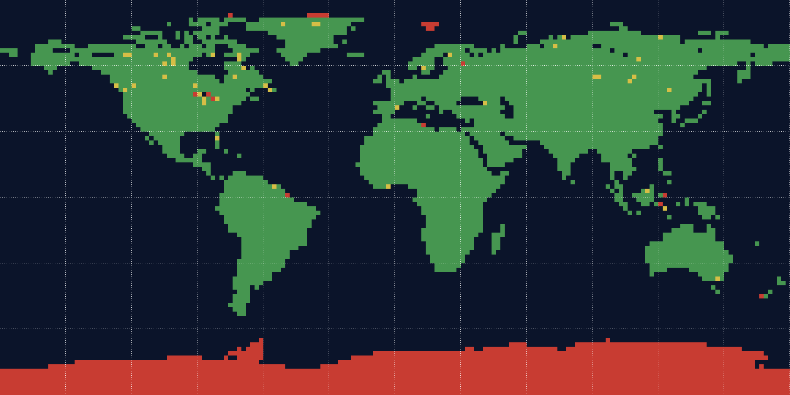

# Where the finer ground has a picture

Read on 2026-11-17: the layer `Landsat_WELD_CorrectedReflectance_TrueColor_Global_Annual` (2000-12-01) at level 11 of NASA's GIBS tiles (one tile, 0.14 degree across, at the middle of each land cell of 2.0 degrees), against the package's own water mask. See `scripts/finer-coverage.py` for how, and what the words mean.

Of the land, **89.3% is covered** (at least 70 per cent of the layer's picture is opaque), **0.9% is thin** (15 to 70 per cent: dark forest and shadow read as clear, and some ice) and **9.8% has none** (the package's coarser ground shows). Pure black, the service's mark for no data, is 9.7% of the land.

## By latitude

| Band | Covered | Thin | None |
|---|---|---|---|
| 80 to 90 | 88% | 0% | 12% |
| 70 to 80 | 97% | 2% | 2% |
| 60 to 70 | 98% | 2% | 0% |
| 50 to 60 | 98% | 2% | 0% |
| 40 to 50 | 98% | 2% | 1% |
| 30 to 40 | 100% | 0% | 0% |
| 20 to 30 | 100% | 0% | 0% |
| 10 to 20 | 100% | 0% | 0% |
| 0 to 10 | 98% | 1% | 1% |
| -10 to 0 | 99% | 0% | 0% |
| -20 to -10 | 100% | 0% | 0% |
| -30 to -20 | 100% | 0% | 0% |
| -40 to -30 | 99% | 1% | 0% |
| -50 to -40 | 96% | 0% | 4% |
| -60 to -50 | 100% | 0% | 0% |
| -70 to -60 | 0% | 0% | 100% |
| -80 to -70 | 0% | 0% | 100% |
| -90 to -80 | 0% | 0% | 100% |

## The largest places with no finer ground

| Area (km2, about) | Latitude | Longitude | Middle |
|---|---|---|---|
| 14,115,629 | -90.0 to -64.0 | -180.0 to 180.0 | -80.19, 14.52 |
| 60,134 | 76.0 to 80.0 | 12.0 to 20.0 | 78.33, 16.0 |
| 49,561 | 0.0 to 2.0 | -50.0 to -48.0 | 1.0, -49.0 |
| 49,561 | 0.0 to 2.0 | 122.0 to 124.0 | 1.0, 123.0 |
| 49,501 | -4.0 to -2.0 | 120.0 to 122.0 | -3.0, 121.0 |
| 41,572 | 32.0 to 34.0 | 12.0 to 14.0 | 33.0, 13.0 |
| 35,050 | 44.0 to 46.0 | -84.0 to -82.0 | 45.0, -83.0 |
| 35,050 | -46.0 to -44.0 | 166.0 to 168.0 | -45.0, 167.0 |
| 33,806 | 46.0 to 48.0 | -92.0 to -90.0 | 47.0, -91.0 |
| 33,806 | 46.0 to 48.0 | -86.0 to -84.0 | 47.0, -85.0 |
| 30,204 | 82.0 to 84.0 | -40.0 to -30.0 | 83.0, -35.0 |
| 24,031 | 60.0 to 62.0 | 30.0 to 32.0 | 61.0, 31.0 |
