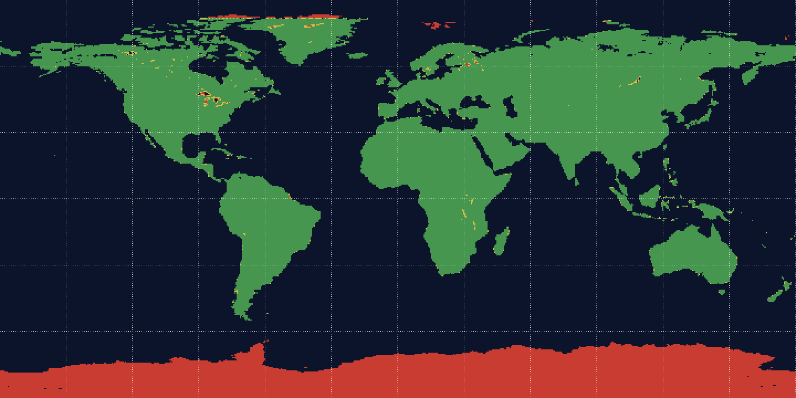

# Where the finer ground has a picture

Read on 2026-11-17: the layer `Landsat_WELD_CorrectedReflectance_TrueColor_Global_Annual` (2000-12-01) at level 5 of NASA's GIBS tiles (every tile, a cell of 0.5 degrees), against the package's own water mask. See `scripts/finer-coverage.py` for how, and what the words mean.

Of the land, **89.6% is covered** (at least 70 per cent of the layer's picture is opaque), **0.9% is thin** (15 to 70 per cent: dark forest and shadow read as clear, and some ice) and **9.6% has none** (the package's coarser ground shows). Pure black, the service's mark for no data, is 9.6% of the land.

## By latitude

| Band | Covered | Thin | None |
|---|---|---|---|
| 80 to 90 | 68% | 9% | 23% |
| 70 to 80 | 97% | 1% | 1% |
| 60 to 70 | 99% | 1% | 0% |
| 50 to 60 | 99% | 1% | 0% |
| 40 to 50 | 98% | 2% | 0% |
| 30 to 40 | 100% | 0% | 0% |
| 20 to 30 | 100% | 0% | 0% |
| 10 to 20 | 99% | 1% | 0% |
| 0 to 10 | 99% | 1% | 0% |
| -10 to 0 | 98% | 2% | 0% |
| -20 to -10 | 99% | 1% | 0% |
| -30 to -20 | 100% | 0% | 0% |
| -40 to -30 | 99% | 1% | 0% |
| -50 to -40 | 96% | 4% | 0% |
| -60 to -50 | 97% | 3% | 0% |
| -70 to -60 | 0% | 0% | 100% |
| -80 to -70 | 0% | 0% | 100% |
| -90 to -80 | 0% | 0% | 100% |

## The largest places with no finer ground

| Area (km2, about) | Latitude | Longitude | Middle |
|---|---|---|---|
| 13,916,776 | -90.0 to -64.5 | -180.0 to 180.0 | -80.25, 14.94 |
| 33,431 | 82.0 to 83.5 | -45.5 to -26.5 | 82.62, -35.17 |
| 28,616 | 82.0 to 83.5 | -82.0 to -62.5 | 82.52, -73.41 |
| 18,739 | 76.5 to 80.0 | 15.0 to 19.5 | 78.37, 17.08 |
| 14,561 | 47.0 to 48.5 | -89.5 to -87.5 | 47.82, -88.46 |
| 11,114 | 43.5 to 45.0 | -87.5 to -86.5 | 44.15, -86.95 |
| 10,573 | 60.0 to 61.5 | 30.5 to 32.5 | 60.82, 31.32 |
| 6,195 | 1.0 to 1.5 | -49.5 to -48.5 | 1.25, -49.0 |
| 5,885 | 78.5 to 79.5 | 12.0 to 15.0 | 79.05, 13.5 |
| 5,126 | 77.5 to 79.0 | 21.0 to 23.5 | 78.06, 22.12 |
| 4,961 | 79.5 to 80.0 | 21.5 to 26.0 | 79.75, 23.75 |
| 4,619 | 72.0 to 73.5 | 175.0 to 176.0 | 72.65, 175.45 |
