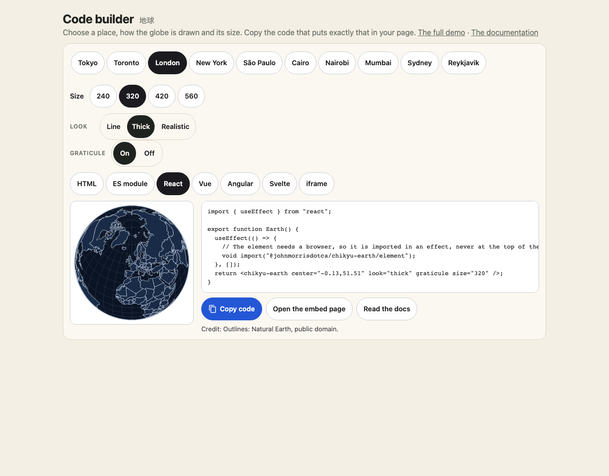

The demo site has a page made to be framed, `embed.html`. It draws what its address says and fetches nothing but its own files, so it needs no script, no build and no package on your side:



```html
<!doctype html>
<html lang="en">
  <head>
    <meta charset="utf-8" />
    <meta name="viewport" content="width=device-width, initial-scale=1" />
    <title>Chikyu Earth in an iframe</title>
  </head>
  <body>
    <iframe
      src="https://johnmorrisdotca.github.io/chikyu-earth/embed.html?look=thick&center=139.7,35.7&turn=1"
      title="The Earth, centred on Tokyo"
      width="420"
      height="420"
      loading="lazy"
      style="border: 0"
    ></iframe>
  </body>
</html>
```

The globe fills the frame (square, at the smaller of its width and height), with a transparent background, so it sits on your page's colour.

## What the address can say

| Parameter | Values | Default |
|---|---|---|
| `look` | `line`, `thick`, `realistic`, `space` (the last two need WebGL; they fall back to `thick` without it) | `line` |
| `center` | `lon,lat`, or `me` to ask the browser for the reader's place | `0,20` |
| `graticule` | `1` | off |
| `turn` | `0` still, `1` turned by hand (drag, wheel, pinch, arrow keys), `auto` turns by itself at the Earth's own rate | `0` |
| `time` | the moment the realistic and space looks show, for example `2026-06-21T12:00Z` | now |
| `clouds`, `lights` | `off` to hide that layer on the realistic look | on |
| `speed` | the space look's clock in seconds of game time a second: `0` holds still, `1` is real time, `86400` runs a day a second, negative runs backwards | `0` |
| `scale` | the space look's scale: `true` for real distances and sizes | compressed |
| `body`, `zoom` | the space look's camera: the body it looks at (`Moon`, `Mars`, ...), and the part of the sky it shows (`earth`, `moon`, `sun`, `inner`, `solar-system`) | the Earth |
| `satellites`, `sat` | the space look's satellites, `stations` and `starlink` (one or both, from the demo site's snapshot of CelesTrak's lists), and the NORAD number of a station to mark, for example `25544` for the ISS | none |
| `ride`, `rview`, `rlook` | the space look's camera riding along with `iss`, `css` (Tiangong), `starlink` (one satellite), `Moon` or `Mars`; `rview=follow` keeps behind it instead of at it; `rlook=horizon` tips the camera towards the horizon (with a satellite, give a `speed` too, or the Earth stays still) | not riding |
| `orbits`, `labels` | the space look's planet paths (`off` hides them) and the names beside the bodies (`1` shows them) | paths on, names off |

By default the frame is still, has no controls and never asks for the reader's location. The space look holds still too (`speed=0`), and draws at most 30 times a second when you give it a speed. It draws only when something changes, and nothing while it is off screen or its tab is hidden.

## Size and accessibility

Give the iframe a `title` (the example does), a `width` and `height`, and `loading="lazy"` so it costs nothing until it is near the screen. The frame is a square: a frame wider than it is tall leaves empty space at the sides.

## Hosting the frame yourself

The frame is `embed.html` with `embed.js` (and the chunks it loads) and the `textures/` folder for `look=realistic`. `pnpm site` builds them into `site/`; copy those files to your own host if you do not want to use the demo site's.
