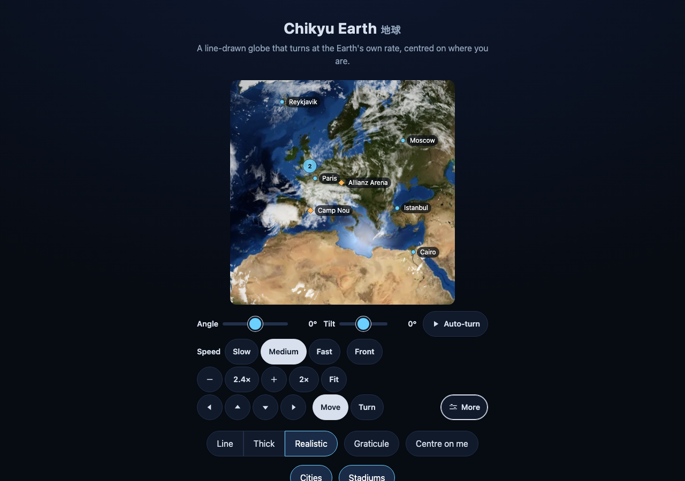

# Markers

`@johnmorrisdotca/chikyu-earth/markers` puts your places on the globe, on the flat `<chikyu-earth>` and on `<chikyu-earth-realistic>` alike. Chikyu ships
no list of cities or stadiums: you bring your own, and the demo shows a few (city centres and stadiums, coordinates from Wikidata, CC0).



```ts
import { attachMarkers } from "@johnmorrisdotca/chikyu-earth/markers";

const earth = document.querySelector("chikyu-earth-realistic")!; // or "chikyu-earth"
const markers = attachMarkers(earth, { maxLabels: 24, clusterRadius: 28 });

markers.addAll([
  { id: "tokyo", lon: 139.69, lat: 35.69, label: "Tokyo", group: "Cities", data: { population: 14_000_000 } },
  { id: "wembley", lon: -0.28, lat: 51.56, label: "Wembley Stadium", group: "Stadiums", icon: "diamond", color: "#ffb454" },
]);
markers.update("tokyo", { color: "#fff" });
markers.hideGroup("Stadiums");
markers.remove("tokyo");

earth.addEventListener("chikyu-marker-click", (event) => console.log(event.detail.marker?.data));
```

`attachMarkers` needs the element to be in the page. It returns the controller; `markers.detach()` takes everything it added away again.

## A marker

`id` (yours, unique), `lon` and `lat` in degrees, and any of: `label` (shown beside the dot when there is room, and its name for a screen reader), `description` (what a screen
reader says instead of the label, a sentence), `color` (any CSS colour), `icon` (`dot`, `ring`, `square`, `diamond`), `size` (4 to 32 pixels, 8), `group`, `priority` (higher
keeps its label when labels crowd) and `data` (yours, given back in every event).

## Groups

`groups()` lists them with their counts and whether each is shown; `showGroup`, `hideGroup` and `toggleGroup(name, force?)` change that. A hidden group's markers are not drawn,
not labelled, not clustered and not in the screen reader's list.

## What it does with them

- **They follow the globe.** A marker turns, zooms and pans with it, is hidden on the far side, and fades over the last stretch before the edge.
- **Crowded places become a cluster.** Markers closer than `clusterRadius` pixels (28) share one disc with their count; zoom in and they come apart. A click on a cluster tells you the ids in it, and zooming is yours to do.
- **Labels make room.** At most `maxLabels` (24) are shown; each goes to the right of its dot, else left, above or below, never over another label and never outside the globe's box; the highest `priority` wins a spot.
- **Events** on the element (they bubble): `chikyu-marker-hover`, `chikyu-marker-click` and `chikyu-marker-focus`, each with `detail: { marker, x, y, cluster? }` (`marker` is your object with your `data`; for a cluster it is `null` and `cluster` lists the ids; `x` and `y` are CSS pixels in the globe's box). A drag that turns the globe is not a click. The element has `data-marker-hover` while a place is under the pointer.
- **A screen reader and the keyboard.** Every shown label is a real button (`aria-label` is the description or label) that Tab reaches; Enter fires `chikyu-marker-click`, focus fires `chikyu-marker-focus`. A visually hidden list names every place (up to 200; over that, how many there are) and is rebuilt only when the markers change.

## The budget

Markers cost a 2D canvas pass and a few buttons, never one DOM element per place:

| | How | The test |
|---|---|---|
| One pass for many markers | every dot, ring and cluster is drawn in one pass into one 2D canvas; markers are grouped into clusters with one pass over a grid | 5,000 markers: under 10 ms for a view change on the flat globe (`e2e/markers.demo.ts`) |
| Few DOM nodes | a pool of at most `maxLabels` buttons, moved with `transform`; nothing else per place; text widths are measured on the canvas, so placing a label reads no layout | 5,000 markers: at most 24 buttons exist |
| Drawn with the Earth, not on its own | the realistic Earth tells the markers where the disc is at each draw; the flat globe, after each redraw | a 5,000-marker drag: marker renders are at most the Earth's draws, and the Earth is drawn at most 30 times a second |
| Nothing at rest | no timer, no frame of its own | 0 renders, 0 GL draws, 0 frame requests in 2 s |
| Nothing out of sight | the Earth stops publishing its pose while paused | 0 marker renders while scrolled away |
| The same canvas budget | 4096 a side and 6 million pixels, ratio 2 (`canvasRatio`) | unit test |

Why a 2D canvas and not instanced WebGL points: the same code must serve the flat SVG globe, which has no GL; a 2D pass of a few thousand dots is as cheap as an instanced draw at these counts
and adds no second GPU path.

The pure parts (`project`, `projectAll`, `clusterPoints`, `placeLabels`, `canvasRatio`) import on a server and have unit tests (10,000 markers cluster and label in about 2 ms).
