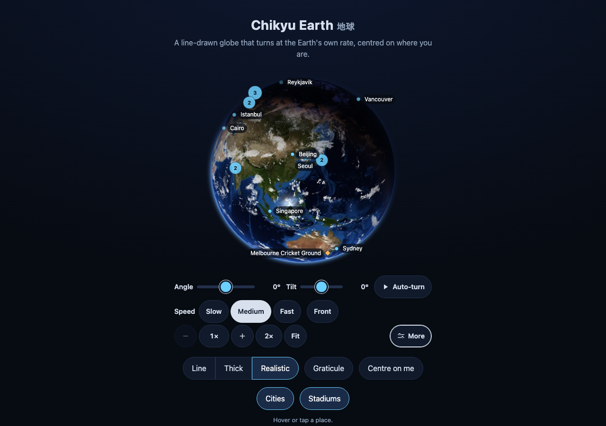

# The realistic Earth

`@johnmorrisdotca/chikyu-earth/realistic/element` registers `<chikyu-earth-realistic>`: the Earth as it looks from space, with its
day side, its night side lit by cities, a drifting cloud layer, a sun glint on the sea, a thin atmosphere at the rim, and the
day and night line where the Sun really is at the moment you give it (now, by default). It is an optional entry point: the flat
`<chikyu-earth>` needs neither three.js nor any picture, and a page that never imports this one pays nothing for it.



## Install

```sh
npm install @johnmorrisdotca/chikyu-earth three @johnmorrisdotca/kazoku-ui
```

`three` (r160 or later) and `@johnmorrisdotca/kazoku-ui` (0.9 or later) are optional peer dependencies: only this entry point needs them.
Types for three come from `@types/three`.

```html
<script type="module">
  import "@johnmorrisdotca/kazoku-ui/view-controls/define";
  import "@johnmorrisdotca/chikyu-earth/realistic/element";
</script>

<div id="globe" tabindex="0">
  <chikyu-earth-realistic texture-base="/textures/"></chikyu-earth-realistic>
</div>
<kazoku-view-controls for="globe" address controls="advanced" tilt-max="90" speed="0.004178" autoplay></kazoku-view-controls>

<script type="module">
  const earth = document.querySelector("chikyu-earth-realistic");
  document.querySelector("kazoku-view-controls").addEventListener("kazoku-viewchange", (event) => {
    earth.setView(event.detail, event.detail.final);
  });
</script>
```

The view is the flat globe's: `setView(view, final)` takes the shared controls' `{ yaw, tilt, zoom, panX, panY }`, `center` is where it starts, and a
page that wants the flat look keeps `<chikyu-earth>` and shows one or the other (the demo's Line, Thick and Realistic buttons do exactly
that, and keep the camera when the choice changes).

## The pictures

Nothing is fetched except these, from `texture-base` (a folder URL): the package ships them in `dist/textures/`, 1.6 MB in all, and the demo copies them
beside its page. If you bundle, copy that folder to where your static files are and set `texture-base`; without the attribute the element looks next to its
own module (`../textures/`), which suits an unbundled page or a CDN that serves the package's files.

| Layer | Widths (a picture is 2:1) | What it is |
|---|---|---|
| `day` | 1024, 2048, 4096 | Blue Marble with topography and bathymetry, September |
| `night` | 1024, 2048 | Black Marble 2016, the cities' lights |
| `clouds` | 1024, 2048 | Blue Marble clouds |
| `water` | 1024, 2048 | where the sea and lakes are, for the sun glint (made from the day picture) |

All are NASA public-domain images (credits in [NOTICE.md](../NOTICE.md)); `pnpm textures` rebuilds them from the sources.

**Small first, sharper on zoom.** The 1024 pictures load first (about 230 KB) and the globe draws as soon as they are in. From then on a layer holds the
smallest width that gives about three texels across the whole circumference for each pixel of the disc's radius (`chooseTier`): at 420 px on an ordinary screen
that is 1024, a zoom of 2 or a Retina screen asks for 2048, a zoom of 5 for 4096. A larger picture is fetched and decoded off the main thread, swapped in
when it is ready, and the smaller one let go. When the zoom drops, the larger one is kept for 4 seconds in case the reader zooms back, then freed.

**Caps.** No texture is wider than 4096 (a day picture at 4096 is about 43 MB on the GPU with its mipmaps; the other layers stay at 2048 or less), `max-texture`
lowers that, and a device that reports 2 GB of memory or less stops at 2048.

## Attributes and properties

| | |
|---|---|
| `center="lon,lat"` | where the view starts (the reader's own place if left out and they allow it, as in the flat element) |
| `time="2026-06-21T12:00Z"` | the moment shown; `now` (the default) follows the clock |
| `clouds="off"`, `lights="off"` | switch the cloud layer or the night lights off |
| `texture-base`, `max-texture` | where the pictures are; the widest one to use |
| `max-ratio` | the most device pixels to a CSS pixel the canvas is drawn at (2 at most; `0.5` draws at half the size and scales it up, for a background). Read when the element connects; the shared renderer keeps it for the whole page |
| `live-seconds` | how often the Sun and clouds are put right while the time is `now` (60) |

Properties: `time` (a number of milliseconds, a `Date` or `"now"`), `centre`, `clouds`, `lights`, `view`, `stats`. Events: `chikyu-ready`,
`chikyu-unavailable` (WebGL missing or a picture would not load; `detail.reason`), `chikyu-tier` (`detail.layer`, `detail.width`). `data-state` is
`loading`, `live`, `lost` or `unavailable`.

**Draws.** Changes made in one task (a `time` and a `setView` together) are one draw.

**Strict Content-Security-Policy.** The elements write their styles as constructable stylesheets, which `style-src 'self'` allows. A browser without them gets a `<style>` that carries the element's `nonce` attribute, so a page can allow it by nonce.

**One context with the page's own renderer.** `setSharedRenderer(renderer)` (from `@johnmorrisdotca/chikyu-earth/realistic/element`, before the first element connects) gives the Earth and the space view a renderer made with kazoku-ui's `createSharedRenderer`, so a page that draws other things with it keeps one WebGL context. The page owns that renderer: its `maxRatio` applies and the elements never dispose it.

## Where the Sun is

`subsolarPoint(ms)` (exported from `@johnmorrisdotca/chikyu-earth/realistic`, no browser needed) gives the point where the Sun stands at the zenith: its
latitude is the Sun's declination and its longitude runs west 15 degrees an hour. It is NOAA's solar calculator (Meeus), tested against the almanac to
0.05 degree: the equinoxes at 0, the solstices at 23.44, 2 November 2026 at -14.8, the equation of time in the longitude. The light comes from there; the
terminator is soft, with a warm dusk band. The view turns the way the Earth does, so the controls' Auto-turn at `0.004178` degrees a second holds the day
and night line still on the screen while the land turns under it.

## The budget, and how it is kept

Chikyu Earth's 3D is lightweight by construction, and each line below is checked by `e2e/realistic.gl.ts` (`pnpm test:demo`; software WebGL in Chromium):

| | How | The test |
|---|---|---|
| Nothing drawn at rest | no animation loop: a draw happens only when the view, the time or a texture changes | 0 draw calls and 0 `requestAnimationFrame` calls in 4 s |
| At most 30 draws a second | changes close together become one draw (`createGate`, 33 ms), 20 on a small device and 15 on a low battery | a drag at 125 moves a second: 29.3 draws a second; 2,700 `setView` calls in 2 s: 59 draws |
| A slow Auto-turn is free | a change under half a pixel is not drawn | 0 draws, 0 frames in 6 s of Auto-turn at the Earth's rate |
| One WebGL context | kazoku-ui's shared renderer | `contexts` is 1 |
| Canvas cap | 6 million pixels, 4096 a side, ratio 2 | a 5K screen at ratio 2 gets 3264 x 1835 = 5.99 MP |
| Texture caps | 4096 at most, only what the zoom needs, freed after | the textures alive grow by 1 a layer and are back to the start after the zoom |
| Paused out of sight and in a hidden tab | the renderer's `IntersectionObserver` and `visibilitychange` | 0 draw calls and 0 frames while scrolled away or hidden; draws again on return |
| Disposed on removal | geometry, materials, textures and the context itself | after `remove()`: 0 buffers, 0 programs, no picture of ours left; and it can be added again |
| Context loss | the renderer prevents the default and the pictures upload again | lost: nothing drawn; restored: drawn again, not black, no error |
| No WebGL | `chikyu-unavailable`; the demo shows the line globe | tested with `getContext` returning null |
| Reduced motion | no Auto-turn (the controls), no animation of its own | the whole suite runs with `reducedMotion: reduce` |
| A 10-minute soak | `pnpm test:soak` turns, zooms, re-times and toggles for `SOAK_MINUTES` | JS heap, GPU objects, canvas and draws are checked at the end against the start (numbers in the changelog) |

The page's own JavaScript is small: the element, the Sun, the scene, the shaders and kazoku-ui's shared renderer are 22.6 KB minified (9.2 KB gzipped); three.js is the page's. A page that
hands over only the parts it uses (`setThreeLoader(() => import("./three-subset"))`, see `demo/three-subset.ts`: `Texture`, `BufferGeometry`, `BufferAttribute`,
`ShaderMaterial`, `Group`, `Mesh`, `Scene`, `OrthographicCamera`, `Vector3`, `WebGLRenderer` and five constants) ships about 188 KB of three gzipped (736 KB minified) instead of all of it.

## One at a time

There is one WebGL context per page. With several `<chikyu-earth-realistic>` elements on a page the one you last touched is live and the others are empty until
you touch them; for a wall of globes use kazoku-ui's renderer directly.
