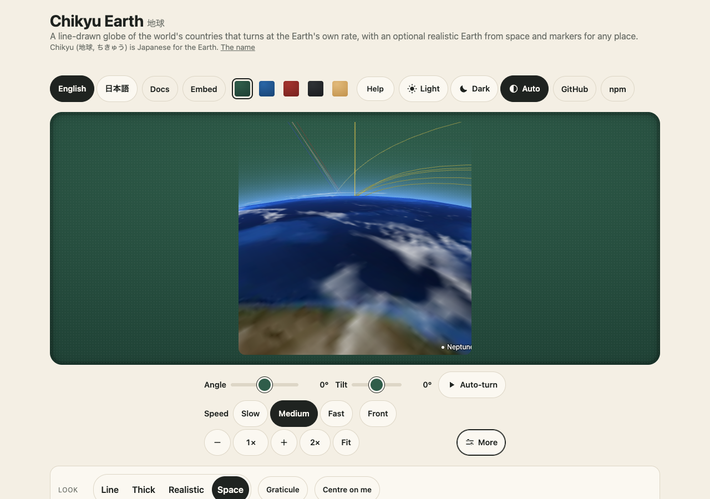

# Riding along

`element.ride(target, options)` on `<chikyu-space>` puts the camera at a moving body (a satellite of a group set with `setSatellites`, the Moon, the Sun or a planet) at its real place for the moment shown,
and looks at the Earth. [guides/ride-along.md](guides/ride-along.md) (Japanese: [guides/ja/ride-along.md](guides/ja/ride-along.md)) has the example; this page is the design and the budget.

## How the camera is placed

- **From it** (`view: "from"`): the camera is at the body. `ridePose` (pure, `@johnmorrisdotca/chikyu-earth/space`) works out where it looks: straight at the Earth's centre, with the way the body is going
  (its velocity, less the part that points at the Earth) at the top of the picture; `look: "horizon"` tips it forward by the Earth's angular radius less 12 degrees, so the horizon is a little above the middle;
  a drag looks about from there, like a head on a pivot (see "Dragging a ride"); their zoom narrows the 60 degree field of view. A satellite's place and velocity are one exact SGP4 call a frame
  (never the interpolation, so the camera is right at any speed); a body's way of going is the difference of its places at the two ends of the ephemeris track.
- **Behind it** (`view: "follow"`): the camera keeps a fixed distance and looks at the body, from the direction the sky was in when the view was last moved (the same camera as "Look at"). For a satellite the
  distance is `distanceKm / zoom`.
- **Outside** (`viewpoint: "outside"`, the default, for a satellite ridden `from` it): `outsidePose` (pure, `/space`) moves that camera 25 km back along its own line of sight turned a little down (the satellite sits 0.56 of half the picture's height below the middle when it looks along the way it goes, so it is behind and above; at the middle looking straight down, so it is straight above), the same way of looking and the same up, so the look-around is unchanged and the picture does not shake. The satellite is drawn at about 9 per cent of the picture's height in radius from the page's model or the package's own small drawing by kind (`genericSatellite`, `satelliteKind`): far larger than the few metres it is, so it is **not to scale**. `inside` is the camera at the satellite.
- **Switching** glides: the camera's place, its turn (a spherical interpolation) and its field of view move from where the last draw left them to the new camera over 1.2 seconds, eased. Reduced motion jumps.
- The body being ridden is not drawn from inside (the camera is inside it), nor is its name; a satellite ridden from outside is drawn (see above).

## Dragging a ride

The camera is fixed to the body, so a drag cannot move the camera; it turns it. A drag right turns the camera to its left and a drag up tips it towards the bottom of its picture, so the ground follows the pointer as it does on the line globe and the
Earth from space (right for right, up for up, about one and a half pixels for each pixel of the drag). The angle for a pixel is the field of view's, so zooming in does not make the ground race away. It is a pan and tilt about the camera's own up and
sideways lines, so it works the same looking straight down (where a turn round the vertical would only spin the picture) and tipped to the horizon. The yaw and tilt are in the address, and a page opened with them looks the same. Behind a satellite (`view: "follow"`) the drag
goes round the satellite and the Earth, which is behind it, follows the pointer.

## When it draws

The space view draws only when something changes and at most 30 times a second (the shared gate). A ride changes the picture all the time, so the clock draws as often as the picture moves a pixel: the speed of
the ground under the camera over its height, times the focal length in pixels (for a satellite), or the turn of the direction to the Earth (for a body), times the clock's speed, from 1 to 30 times a second.
Paused: no timer, nothing drawn. Out of sight or in a hidden tab: the renderer draws nothing. Reduced motion: one update a second and no glide.

## The budget, and how each part is tested (`e2e/ride.gl.ts`, `e2e/space.soak.ts`, `e2e/freeze.demo.ts`)

| | The test |
|---|---|
| The camera is where the body is | the ISS: within 1 km of satellite.js's own place, 420 km up; the Moon: 10 Earth radii away (compressed), 55 to 66 in the true scale |
| It moves as the body does | the ISS at 60x: the camera goes round the Earth at the ISS's rate (within 2.5 degrees over 5 seconds) |
| Frame rate capped | ride the ISS at real time and at 60x, and Mars at a day a second: see the changelog for the frames a second; none over 30 |
| Nothing at rest | paused: 0 GL draws, 0 frame requests in 3 s; after a glide it rests |
| Nothing out of sight | scrolled away or a hidden tab at 60x: 0 GL draws |
| Reduced motion | no glide; about 1 frame a second at 60x |
| A drag moves the ground the way the pointer goes | `e2e/drag.gl.ts`: real pointer drags, arrow keys and Auto-turn on the ISS (down and at the horizon), the Moon and behind them; the ground's move is found by sliding the first picture over the second |
| The address keeps the turn | `e2e/drag.gl.ts`: a ride opens with the address's yaw and tilt, a drag writes them back, and the address brings the same picture back |
| Smooth switching ends | the glide from the ISS to the Moon takes about 1.2 s, is part of the way after half a second, and then 0 draws |
| Lost target | elements too old for the date: `chikyu-ride-lost`, the ordinary camera |
| Dispose, recover | five switches and a stop leave the buffers and textures where they were; a lost context comes back and still rides |
| Soak | rides of every kind in the ten-minute soak: heap, GPU objects and draws flat (numbers in the changelog) |
