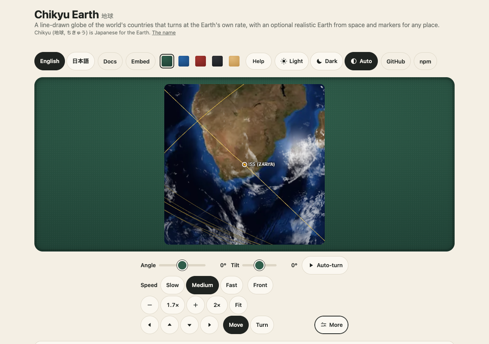

# Satellites

`createSatellites(sets)` (`@johnmorrisdotca/chikyu-earth/satellites`) turns orbital elements into positions with SGP4, and `<chikyu-space>` draws them: `setSatellites("stations", group)`.
The package fetches nothing and ships no orbital data; your page passes the elements in. The guide ([guides/satellites.md](guides/satellites.md), Japanese: [guides/ja/satellites.md](guides/ja/satellites.md))
has the example and the rules; this page is the design and the budget.

## Where the maths run, and how often

SGP4 (satellite.js 6, MIT, 10 KB gzipped, an optional peer) is run for a whole group at two moments a step apart and every position in between is an interpolation, so a steady clock costs **one batch a step** and every
frame in between is arithmetic. The step is a second of wall time of the clock's speed: 1 second at real time, up to 60 seconds at 60 times real time (the interpolation's error is then at most a few kilometres, a pixel
or less on the Earth's disc). Above 60 times real time the groups are **hidden and SGP4 is not run** (`MAX_SATELLITE_SPEED`); a satellite that was chosen is still placed exactly, one SGP4 call a frame.
Elements older than 14 days at the moment shown (`maxAgeDays`) are left out, because SGP4's error grows by a few kilometres a day; the demo shows the age of the snapshot and moves its date to the snapshot's own day
when it is too old for today.

Positions are in the space view's axes (TEME's x, z, -y: x to the vernal equinox, y north) in Earth radii (6371 km), which is the Earth's own frame there: a unit test checks that a satellite's longitude from these axes and the
scene's sidereal time agrees with satellite.js's own geodetic longitude within 0.02 degree, and an end-to-end test centres the view under the ISS and finds it in the middle.

## What is drawn

One `THREE.Points` a group (one draw call), a shader that draws a soft round dot of a fixed size in CSS pixels; a chosen satellite gets a ring and its orbit (one revolution, 120 points, in order along the path); a group of
40 or fewer (the stations) can draw every orbit (`orbits: true`). A press asks the group for the dot nearest the point (all dots projected once, only on a press) and ignores one behind the Earth.

## The budget, and how each part is tested (`e2e/satellites.gl.ts`, `e2e/space.soak.ts`, `e2e/freeze.demo.ts`)

| | How | The test |
|---|---|---|
| Nothing at rest | paused: no timer, no frame | 0 GL draws, 0 frame requests, 0 SGP4 calls in 3.5 s with 8,252 satellites on |
| SGP4 about once a second | two batches a step, then one a step | at 60x, 8,252 satellites: 8,242 SGP4 calls a second (one each); at real time 2,252 satellites: 2,249 a second |
| One draw call for a group | `THREE.Points` | 34.2 GL draw calls a frame with 6,000 more satellites, 33.4 without |
| Frame rate capped | the clock draws 1 to 30 times a second as the picture moves | 29.0 frames a second at 60x; at real time 1 a second |
| Reduced motion steps | one update a second | `prefers-reduced-motion: reduce` at 60x: 1.00 frames a second |
| Light on the main thread | interpolation is a loop over 6,000 x 3 numbers | 0.09 ms of JavaScript a frame on average at 60x with 8,252 satellites, the longest SGP4 batch 2.6 ms |
| Out of sight draws nothing | the renderer pauses | 0 GL draws scrolled away or in a hidden tab, with 6,000 satellites at 60x |
| Too fast is not drawn wrongly | hidden above 60x, no SGP4 | 3600x: 0 SGP4 calls a second, frame rate still capped |
| Dispose, recover | a group taken away frees its buffer; a lost context comes back with the satellites | buffers back to the start; recovered with 2,252 placed, no error |
| Soak | `pnpm test:soak`: groups added, taken away, chosen and run past their limit | heap 13.2 to 13.4 MB, GPU objects 123 to 123 over a minute (numbers for ten minutes in the changelog) |

The numbers are from the software drawing the tests use on a laptop; on a graphics card the drawing is cheaper and the JavaScript is the same.

## The demo's data

`demo/elements/` (demo site only, never in the npm package): one file for each of the fourteen groups of the catalogue (`SATELLITE_GROUPS`), made from one download of each CelesTrak list on 2026-11-03, with every
fifth Starlink satellite (2,231 of 11,155), as rows of numbers; `manifest.json` says what exists and when it was retrieved, `index.json` holds every name for the demo's Find box. `scripts/elements.ts from-dir` makes the files from
downloaded lists and fetches nothing. Credit and the policy: [NOTICE.md](../NOTICE.md). A page that wants live elements fetches them itself, at most once every two hours for a list, and stops on any answer that is not 200
([satellite-sources.md](satellite-sources.md) has every source's terms and where each may go). `demo/celestrak-snapshot.json` (the stations and every fifth Starlink satellite of 2026-11-02) is what the embed page and the older tests still read.

## The catalogue

`SATELLITE_GROUPS` (fourteen groups, each with its CelesTrak list or catalogue numbers, an orbit kind, whether it sits still, and a line in English and Japanese) and `CATALOGUE` (about forty satellites by NORAD number, with a line each)
carry no elements. `findInCatalogue` finds by name, number or what a satellite does. JWST is left out on purpose: it is not in Earth orbit.
