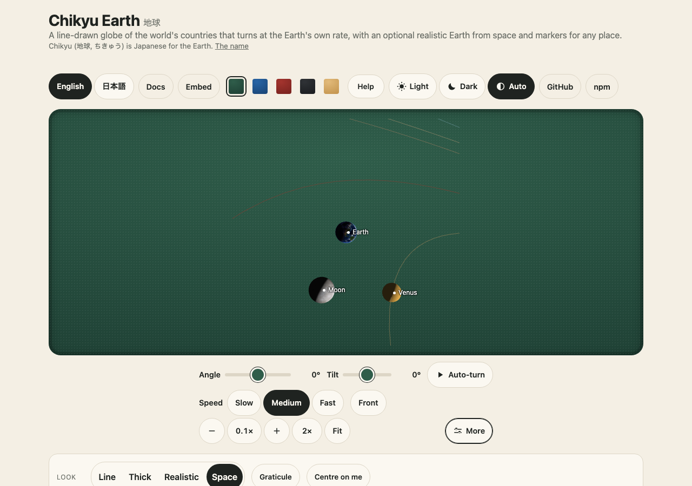

# The space view

The solar system belongs to [wakusei-planets](https://github.com/johnmorrisdotca/wakusei-planets); this view is moving there, and this package keeps the Earth and its satellites. [Why two packages](guides/two-packages.md) has the rule.

`@johnmorrisdotca/chikyu-earth/space/element` registers `<chikyu-space>`: the Earth, the Moon, the Sun and the planets in their places for a date and time, with the
Moon's phase and the Earth's sunlit side coming out of the light, not out of a table. Zoom from the Earth out to the whole solar system and back; run time forwards or
backwards. It is an optional entry point: the line globe and the Earth from space need neither it nor its ephemeris library.



## Install

```sh
npm install @johnmorrisdotca/chikyu-earth three @johnmorrisdotca/kazoku-ui astronomy-engine
```

`three`, `@johnmorrisdotca/kazoku-ui` and `astronomy-engine` ([MIT](https://github.com/cosinekitty/astronomy), Don Cross) are optional peers: only this entry point uses the third.
The pictures are the Earth's and the Moon's (`dist/textures/`, 1.85 MB in all); the planets are plain colours.

```html
<script type="module">
  import "@johnmorrisdotca/kazoku-ui/view-controls/define";
  import "@johnmorrisdotca/chikyu-earth/space/element";
</script>
<chikyu-space id="sky" tabindex="0" time="2026-11-02T14:00Z" speed="0" texture-base="/textures/"></chikyu-space>
<kazoku-view-controls for="sky" address tilt-max="90"></kazoku-view-controls>
<script type="module">
  const sky = document.querySelector("chikyu-space");
  document.querySelector("kazoku-view-controls").addEventListener("kazoku-viewchange", (e) => sky.setView(e.detail));
</script>
```

The element carries the drag, pinch, wheel and keys itself, with a zoom range of one millionth to 2.5 (0.5 to 6 while riding from a body), so the bar is only for buttons and the address; `zoom-min` and `zoom-max` change the range. The zoom goes out far enough because the camera sits `3.4 / zoom` Earth radii from the Earth's centre: zoom 1 shows the Earth, 0.1 shows
the Moon's neighbourhood, 0.005 the planets. `sky.zoomFor("moon" | "sun" | "inner" | "solar-system" | "earth")` gives the zoom that shows each part of the sky at the
current scale and moment (`controller.set({ zoom }, true, "jump")` goes there). Yaw and tilt turn the camera round the Earth (a drag right or up moves the Earth's surface right or up); it is fixed to the stars, so the Earth
turns under it as time runs.

## Two scales, and which is shown

Space is mostly empty, so a picture at true scale shows two dots. The element has both and says which:

| `scale` | Distances | Sizes |
|---|---|---|
| `compressed` (default) | Every direction is real. The Moon is drawn 10 Earth radii away (it is 60); the Sun 44 (it is 23,500); each planet is drawn in its real direction from the Sun at 44 radii times its distance in astronomical units to the power 0.45, so the Earth's own orbit is the 44 and Neptune's about 200 (it is 30 times as far) | the Sun 5, the Moon 0.9 and the planets 0.5 to 1.8 Earth radii (larger than life) |
| `true` | Real distances and sizes, the Earth's radius for a unit | real: the planets are specks and the Sun is a dot with a glow; names mark where they are |

The demo shows a line saying "Compressed scale: ..." under the controls whenever the compressed one is on.

## Time

`time` is an ISO date (`2026-11-02T14:00Z`) or `now`; `speed` is game seconds a second: `1` real time, `0` held still, `3600` an hour a second, `86400` a day a second, negative runs
backwards. The demo's Time row is the family's speed buttons (kazoku-ui's `<kazoku-speed-buttons>`) with those steps, `0 1 3600 86400 -3600`, read as multiples of real time. Setting `time` points the camera at the same place on the ground again. The Sun is where `astronomy-engine` says (apparent, with aberration), the Earth is turned
by Greenwich sidereal time, the Moon shows its near side to the Earth (its libration, up to 8 degrees, is not drawn), and each planet is lit from the Sun, so Venus has its crescent and
the Moon its quarter.

## Lighting

`element.light` (attribute `light`) is `sun` (the true light, the night side dark, the default), `lit` (the Earth lit as if by daylight from the camera's side: the day picture, no city lights, never a black frame on the night side of a ride) or `boost`
(the true terminator with the night side raised so land and coasts read). The Sun, the Moon and the planets keep their true places in every mode; `<chikyu-earth-realistic>` takes the same attribute.

## Looking at a body, and choosing one

`element.body = "Jupiter"` points the camera at a body (Earth, Moon, Sun, Mercury to Neptune, and Pluto); at zoom 1 it fills the view. The name beside each body is a button (Tab, Enter) and a press on a body
that is not a drag fires `chikyu-body-click` (`chikyu-body-focus` for the keyboard) with `{ name, radiusKm, distanceKm }`; `element.bodyInfo(name)` gives the same. What happens next is the page's: the demo looks at the body
and prints a line about it.

## The seam for drawing the bodies

The Earth and the Moon keep their pictures here. The Sun, the planets and Pluto are drawn by a `BodyPainter` (`@johnmorrisdotca/chikyu-earth/space`: `plainPainter`, `BodyPainter`, `BodyDrawing`, `BodyMoon`,
`PaintContext`, and `setBodyPainter` from the element module). Left alone they are plain spheres in the right colours (and a glow for the Sun). With `@johnmorrisdotca/wakusei-planets/painter` (an optional peer)
they are the real ones, in a `realistic` or `painted` look (`bodies="painted"`), with Saturn's rings, and with the moons round a planet once it is a few pixels across (`zoomFor("Jupiter-moons")`): see the
guide [The real Sun, planets, Pluto and moons](guides/the-real-planets.md). The view decides where each body is, how big it is (the real ratio in true scale), which way the Sun lights it, and what it is called;
a painter's `make(three, name, context)` returns an object of radius 1 (or a promise of one) and, optionally, `update({ toSun, ms, radiusPx })` (called at each draw), `light(toSun)`, `billboard: true` and `dispose()`; its
optional `moons(planet, ms)` places a planet's moons in planet radii and `looks` names what `bodies` may be.

## Satellites

`element.setSatellites("stations", createSatellites(elements))` (from `@johnmorrisdotca/chikyu-earth/satellites`) draws satellites at the places SGP4 puts them, in one draw call a group; `showSatellites`, `selectSatellite`, `satelliteInfo`,
the `chikyu-satellite-click` event and `stats.satellites` go with it. Elements come from your page, nothing is fetched. [satellites.md](satellites.md).

## Riding along

`element.ride("Moon")` or `element.ride({ group, index })` puts the camera at the body and looks at the Earth; `ride(null)` stops. [ride-along.md](ride-along.md).

## Properties, events, stats

Attributes and properties: `center`, `time`, `speed`, `scale`, `labels` (names beside the bodies), `orbits` (the planets' paths round the Sun), `texture-base`, `max-texture`; property `body`. `setView(view)` takes
the shared controls' yaw, tilt and zoom (pan is not used). Events: `chikyu-ready`, `chikyu-unavailable`, `chikyu-time` (while time runs), `chikyu-body-click`, `chikyu-body-focus`. `stats` has `state`, `draws`, `contexts`, `canvas`,
`tiers`, `distance`, `time` and `lookups`.

## The budget, and how each part is tested (`e2e/space.gl.ts`, `e2e/space.soak.ts`)

The same rules as the Earth from space (one WebGL context through kazoku-ui's shared renderer, a canvas inside 4096 a side and 6 MP, textures that follow the zoom and are freed, nothing drawn out of
sight, everything disposed, a lost context recovered), and these for time:

| | How | The test |
|---|---|---|
| Nothing at rest | `speed="0"`: no timer, no frame | 0 draw calls and 0 frame requests in 4 s |
| Real time costs a draw a minute | the clock ticks once a minute at 1x | 0 draw calls in 6 s |
| Fast time is capped | a draw per pixel the Earth's turn moves, 1 to 30 a second | a day a second: 29.4 draws a second, 1.00 days a second |
| The ephemeris is looked up about once a second, not once a frame | two lookups a game-second span, interpolated between (`createTrack`) | a day a second: 2.0 lookups a second for 29 draws a second; the interpolation is within 0.1 degree of the Moon's true place (unit test) |
| Out of sight a running clock draws nothing | the renderer pauses | 0 draws, 0 frames while scrolled away at a day a second |
| Dispose and recover | as the Earth | removal frees our textures, buffers and programs; a lost context is restored without error |
| Soak | `pnpm test:soak` runs `e2e/space.soak.ts` too: Earth to solar system and back, speeds, scales, toggles | heap, GPU objects and draws compared with the start (numbers in the changelog) |

The ephemeris module (`@johnmorrisdotca/chikyu-earth/space`: `frameAt`, `createTrack`, `orbitPath`, `compress`, `placeAround`) imports on a server and has unit tests: the Sun's distance and declination in the
seasons, the Moon at the new and full moon, the planets' places round the Sun, the interpolation, both scales.
